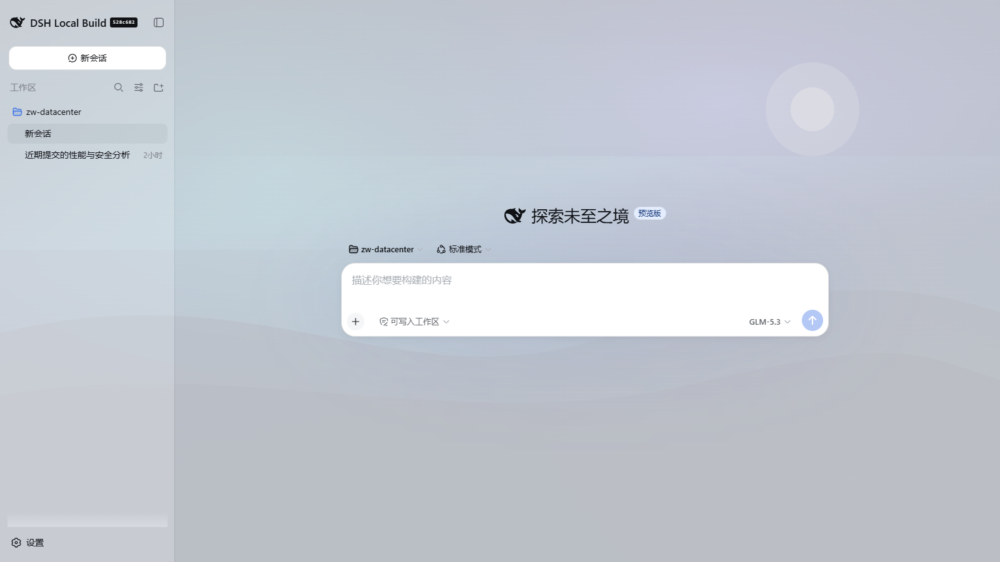
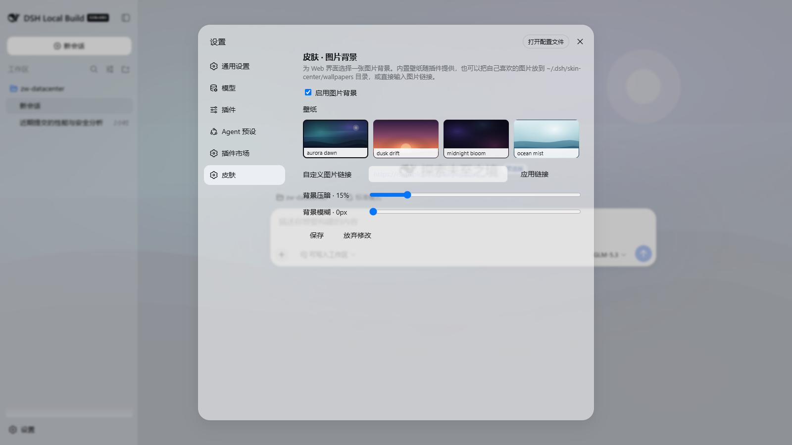
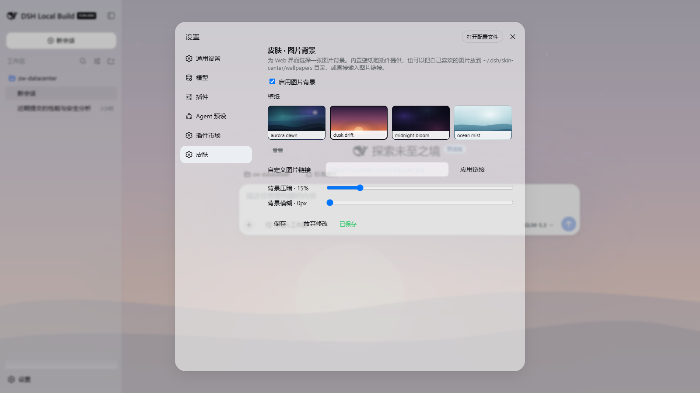

# dsh-skin-background

DeepSeek Harness (dsh) 皮肤插件：给 Web 界面加上可切换的图片背景。English summary below.







- 内置 4 张原创渐变壁纸（aurora-dawn / dusk-drift / ocean-mist / midnight-bloom），也支持用户目录 `~/.dsh/skin-center/wallpapers` 中放入自己的图片，或输入任意 http(s) 图片链接
- 皮肤面板出现在「设置 → 图片背景」：启用开关、壁纸选择（含本地上传与删除，超过 5MB 自动压缩，动图退化为静帧）、自定义链接、主面板透明度（0–100%，越高越透明）、设置页透明度（0–100%，设置与插件页共用）与背景模糊（0–60px）滑杆，保存后即时生效
- 深浅色自适应：设置/插件窗口的透明度连续可调（通过 `ctx.theme.overrideTokens` 叠加 token 层），深色模式下加一层更深的暗纱保证文字对比度
- 设置通过 profile patch 层（`skin-background` entry）持久化，带写入校验（拒绝 `javascript:` 等非法图片引用）
- 适配 dsh **0.2.0-rc.2**（自 0.1.7-rc.2 起的宿主/客户端 API 均兼容：`configForms`、`overrideTokens`、`slots` 与 `plugins.bundle.config` 槽位、`webServer.register`）

## 安装

```bash
# 在 deepseek-harness 仓库目录下
pnpm dsh plugin --profile web add /path/to/dsh-skin-background
```

安装前先构建：`pnpm install && pnpm build`（产物为 `lib/index.js` 宿主半边 + `lib/client.js` 浏览器半边）。然后重启 `dsh web`。

## 开发

```bash
pnpm install
pnpm test        # vitest（node + jsdom）
pnpm build       # tsc 类型产物 + tsdown 双半边打包
```

目录结构：`src/index.ts` 宿主半边（设置命名空间 + `/skin-background/wallpapers` 路由），`src/client/` 浏览器半边（皮肤应用 `SkinController`、设置界面 `SkinSection`、词典）。

English: a skin plugin for the DeepSeek Harness web client adding a selectable image background. Ships four original gradient wallpapers, serves user wallpapers from `~/.dsh/skin-center/wallpapers`, accepts any http(s) image URL, and exposes a Settings → Skin page with enable/dim/blur controls. Surfaces turn translucent-glass via the theme token override API; everything persists through the `skin-background` settings namespace with write validation. Targets dsh 0.2.0-rc.2 (compatible with every host back to 0.1.7-rc.2: `configForms`, `overrideTokens`, `slots`, the `plugins.bundle.config` slot, and `webServer.register` are unchanged).
